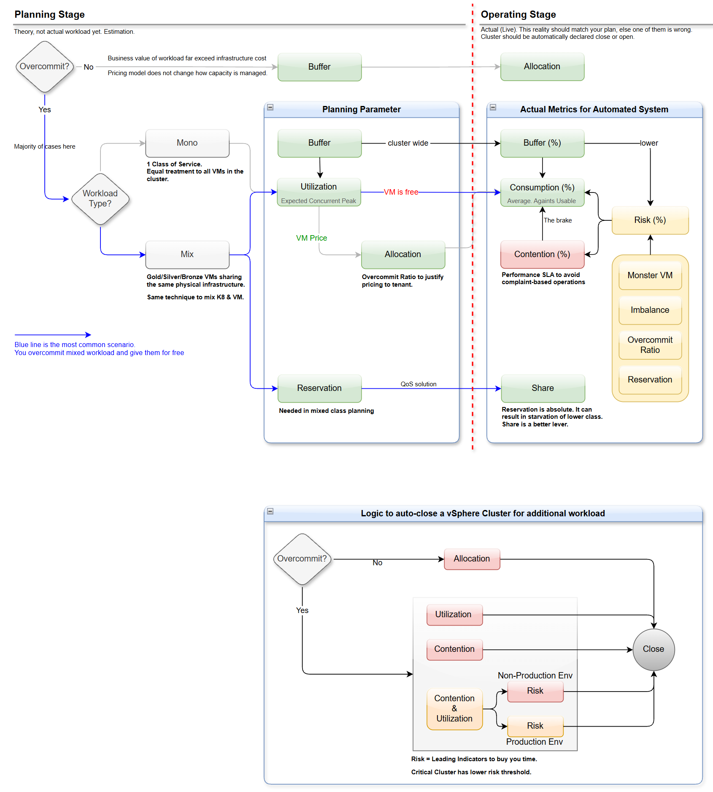

# Capacity Management Model

The capacity model decides whether a vSphere cluster can take more VMs. The pack makes that decision for every cluster from live data, and publishes it as **Close for Business**. The decision combines three measures:

- **Consumption**: how much of the cluster's capacity is used.
- **Contention**: whether the VMs already wait for resources.
- **Risk**: how close the cluster is to contention.

This page describes the model and how its parts relate. The calculation of each metric is on its own page under [Metrics](../reference/metrics/README.md).

## Two stages

| | Planning stage | Operating stage |
| :--- | :--- | :--- |
| What it is | Estimates made before there is a workload. | The live workload. |
| Who does it | The architect, once per cluster design | The pack, every collection cycle |
| Output | Planning parameters: buffer, utilization, allocation, reservation | Live metrics, and an automatic decision to close or open the cluster |

The two stages should agree. If the live cluster closes much earlier or much later than the plan predicted, revisit the plan or find out what changed in the workload.

## Planning stage

The first decision is whether to overcommit.

**Without overcommit**, each VM gets the physical capacity it is allocated. This is the simplest model and the most expensive one. It suits workloads whose business value is far higher than the cost of the infrastructure. The plan has two parameters:

- **Buffer**: capacity kept free for HA and DR.
- **Allocation**: the cluster is full when the allocation reaches the **usable** capacity, which is the total capacity minus the buffer.

**With overcommit**, which most clusters use, the plan depends on the workload type:

| Workload type | What it means | Planning parameters |
| :--- | :--- | :--- |
| **Mono** | One class of service. Every VM in the cluster gets equal treatment. | Buffer, Utilization |
| **Mix** | Gold, Silver and Bronze VMs share the same hosts. Running Kubernetes next to VMs uses the same technique. | Buffer, Utilization, Reservation |

| Planning parameter | Meaning |
| :--- | :--- |
| **Buffer** | Capacity kept free for HA and DR. It sets how high Utilization can go. |
| **Utilization** | The expected concurrent peak. VMs don't all peak at the same time, so this is lower than the sum of the VM sizes. |
| **Allocation** | The overcommit ratio. When VMs are charged to a tenant, it is derived from Utilization and justifies the price. When VMs are free, Utilization drives the plan on its own. |
| **Reservation** | The guaranteed capacity of the higher class in a mixed cluster, which sets its quality of service. |

The blue line in the diagram is the most common case: an overcommitted cluster with a mixed workload, where VMs are free to the consumer.

## Operating stage

In operation, each planning parameter has a live counterpart. For example, the planned Utilization becomes the measured Consumption. Contention and Risk can only be measured, so they appear only in this stage.

| Live measure | Question it answers | In the pack |
| :--- | :--- | :--- |
| **Buffer (%)** | Is the HA and DR capacity still free? Measured cluster-wide. | HA and the Capacity Buffer, subtracted from Total Capacity to give the Usable Capacity of [Cluster Consumption](../reference/metrics/cluster-consumption.md#usable-capacity) |
| **Consumption (%)** | How much of the usable capacity is consumed? The average over the cluster. | [Cluster Consumption](../reference/metrics/cluster-consumption.md) |
| **Contention (%)** | Are the VMs waiting for resources? This is the performance SLA. | [Cluster Performance](../reference/metrics/cluster-performance.md) |
| **Risk (%)** | How close is the cluster to contention? | [Cluster Risk](../reference/metrics/cluster-risk.md) |
| **Share** | Does each class get its fair part during contention? | [VM Shares](../reference/metrics/vm-shares.md) |

### How the measures relate

- **Buffer limits Consumption.** VMs can't use the capacity reserved for HA and DR, so Consumption is measured against the usable capacity. A cluster at 80 % of its total capacity is full if its buffer is 20 %.
- **A smaller buffer raises the risk.** With less headroom, Consumption turns red sooner. The buffer affects the numbers only through the usable capacity. Cluster Risk has no buffer input.
- **Contention caps Consumption.** No consumption level is safe if VMs already wait for CPU, memory or disk. The point where contention starts is the practical limit of a cluster. It differs per cluster, because it depends on the workload, the VM sizes and the hardware. Contention is measured at the VM, because the VM's experience is what the SLA covers. It replaces waiting for users to complain.
- **Risk affects both Consumption and Contention.** Risk is a set of leading indicators that make contention start at a lower consumption than expected:
  - **Monster VM**: a VM that is large compared to its host. It is hard to place, especially after a host failure, and it competes with everything else on the host.
  - **Imbalance**: both hyper-threads of a core are busy. Each thread then gets much less than a full core, so thread utilization overstates the headroom.
  - **Overcommit ratio**: more vCPUs and memory are promised than the hosts have. Whether this causes contention depends on how many VMs peak at the same time.
  - **Reservation**: capacity promised to some VMs whether they use it or not. The other VMs compete for the rest.
- **Shares are the better tool for classes of service.** A reservation is absolute and can starve the lower class. Shares act only during contention, and give each class its proportion.

### Cluster-wide or worst host

The three KPIs look at the cluster in different ways:

- **Consumption is cluster-wide.** DRS moves VMs to balance the hosts, so the capacity of the cluster is the sum of its hosts. It is measured against usable capacity, because HA and the buffer are reserved across the cluster, not on one host.
- **Risk uses the worst host.** A VM runs on one host. One full host hurts its VMs while the cluster average still looks fine, and DRS can't always fix this: a monster VM, affinity rules or reservations can pin load to one host. A host has no usable capacity of its own, so its numbers are measured against what the host physically has.
- **Contention comes from the VMs**: the worst VM and the 90th percentile of the VMs. Together they show how deep and how widespread the problem is.

## Closing the cluster

The aim of the operating stage is to open and close clusters for new VMs automatically, from live data, without someone reading charts. The lower part of the diagram shows the logic:

| Path | Condition | Reason |
| :--- | :--- | :--- |
| No overcommit | Allocation is red. | The usable capacity is fully allocated. |
| Overcommit | Consumption is red. | The cluster is full. |
| Overcommit | Contention is red. | The VMs already suffer. |
| Overcommit | Contention and Consumption are both orange, and Risk crosses its threshold. | The cluster is both busy and slow, and Risk shows which way it is heading. |

Risk is a leading indicator, so it is checked only when Contention and Consumption are both orange. A critical cluster uses a lower Risk threshold: red for non-production, orange for production.

### As built in the pack

The pack implements the overcommit path in the [Periodic Cluster Check](../reference/metrics/periodic-cluster-check.md):

- The three KPIs use the same 0-100 % scale and the same four bands, so one rule covers all three. Performance is higher-is-better. Risk and Consumption are higher-is-worse.
- **Close for Business** is 1 when Consumption or Contention is red, or when both are orange and Risk is orange or red. Risk alone never closes a cluster.
- Every cluster uses the lower Risk threshold from the diagram, orange, which is the one for critical clusters.
- Cluster Consumption is measured against usable capacity: Total − HA − Buffer, as VCF Operations calculates it from the cluster's HA admission control and the Capacity Buffer (Demand) in its policy.
- Cluster Risk is measured against each host's physical capacity. Besides the four leading indicators in the diagram, it also scores the busiest host's utilization and memory saturation.
- Each KPI is taken from the worst part of the period, not its latest value. A cluster that is in trouble for an hour every day should not get new VMs, but a single short spike should not close it. See [Worst](../reference/metrics/periodic-cluster-check.md#worst).
- The decision is published as a metric on the cluster once per period, for dashboards, reports, alerts and placement automation. See the [vSphere Cluster Capacity 2.0 Dashboard](../user-guide/vsphere-cluster-capacity-dashboard.md).
