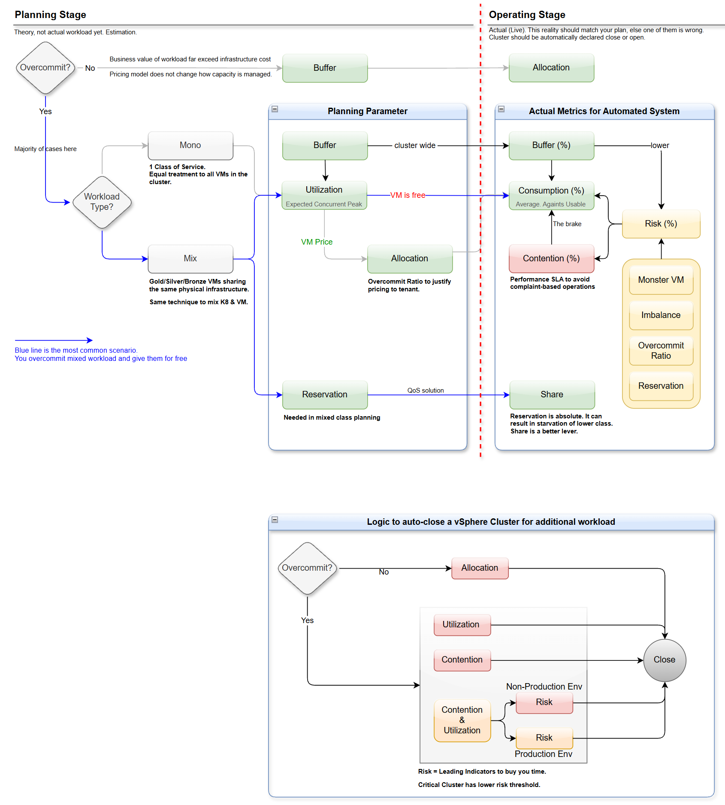

# Capacity Management Model

Capacity management of a vSphere cluster comes down to one question: **can this cluster take more VMs?** The pack answers it automatically, for every cluster, from live data. It blends three views of the cluster into one decision, **Close for Business**:

- **Consumption**: how much of the cluster is used.
- **Contention**: whether the VMs already suffer.
- **Risk**: how close the cluster is to suffering.

This page is the functional architecture: what each part is for, and how the parts relate. How each metric is calculated is in its own page under [Metrics](../reference/metrics/README.md).

## Two stages

| | Planning stage | Operating stage |
| :--- | :--- | :--- |
| What it is | Theory. There is no workload yet, only estimates. | Actual, live workload. |
| Who does it | The architect, once per cluster design | The pack, every collection cycle |
| Output | Planning parameters: buffer, utilization, allocation, reservation | Live metrics, and the cluster declared closed or open, automatically |

The two must agree. When the live cluster closes much earlier, or much later, than the plan said, either the plan or the reality is wrong, and one of them must change.

## Planning stage

The first decision is whether to overcommit.

**No overcommit.** Each VM gets the physical capacity it is allocated. This is the simplest and the costliest model, chosen when the business value of the workload far exceeds the cost of the infrastructure. The plan has two parameters:

- **Buffer**: capacity kept free for HA and DR.
- **Allocation**: the cluster is full when the allocation reaches the **usable** capacity: the total capacity minus the buffer, not the total capacity.

**Overcommit.** The majority of clusters. The plan then depends on the workload type:

| Workload type | What it means | Planning parameters |
| :--- | :--- | :--- |
| **Mono** | One class of service. Every VM in the cluster gets equal treatment. | Buffer, Utilization |
| **Mix** | Gold, Silver and Bronze VMs run on the same physical infrastructure. Mixing Kubernetes and VMs uses the same technique. | Buffer, Utilization, Reservation |

| Planning parameter | Meaning |
| :--- | :--- |
| **Buffer** | Capacity kept free for HA and DR. It sets how high Utilization may go. |
| **Utilization** | The expected concurrent peak: not the sum of the VM sizes, because the VMs do not peak at the same time. |
| **Allocation** | The overcommit ratio, derived from Utilization when VMs are priced: it justifies the price to the tenant. Where VMs are free, there is no price to justify, and Utilization drives the plan on its own. |
| **Reservation** | The guarantee for the higher class in a mixed cluster: its quality of service. |

The most common case is the blue line in the diagram: an overcommitted cluster with mixed workload, where the VMs are free to the consumer.

## Operating stage

In operation, each planning parameter becomes a live metric: the planned Utilization becomes the measured Consumption. Contention and Risk exist only here: they cannot be planned, only measured.

| Live measure | What it answers | In the pack |
| :--- | :--- | :--- |
| **Buffer (%)** | Is the HA and DR capacity still free? Cluster-wide. | The HA failover level, subtracted in [Capacity Utilization](../reference/metrics/capacity-utilization.md) |
| **Consumption (%)** | How much of the usable capacity is consumed? The average over the cluster. | [Cluster Consumption](../reference/metrics/cluster-consumption.md) |
| **Contention (%)** | Do the VMs already suffer? The performance SLA. | [Cluster Performance](../reference/metrics/cluster-performance.md) |
| **Risk (%)** | How close is the cluster to contention? | [Cluster Risk](../reference/metrics/cluster-risk.md) |
| **Share** | Does each class get its fair part under contention? | [VM Shares](../reference/metrics/vm-shares.md) |

### How the measures relate

- **Buffer limits Consumption.** The capacity kept for HA and DR is not available to VMs, so Consumption is measured against the usable capacity, not the total. A cluster at 80 % of its total capacity is full if 20 % is its buffer.
- **A lower Buffer raises Risk.** Less headroom means less room before Consumption turns red. This is common sense, not a calculation: the buffer reaches the numbers only through usable capacity, and Cluster Risk has no buffer input.
- **Contention is the brake on Consumption.** No consumption figure is safe if the VMs already wait for CPU, memory or disk. The point where contention starts is the real ceiling of a cluster, and it differs per cluster. It depends on the workload, the VM sizes and the hardware. Contention is measured at the VM, because the VM's experience is the SLA: monitoring by complaint is what it replaces.
- **Risk feeds both Consumption and Contention.** Risk is the set of leading indicators that make contention appear at a lower consumption than expected:
  - **Monster VM**: a VM too big for its host. It is hard to place, after a host failure in particular, and it competes with everything on its host.
  - **Imbalance**: both hyper-threads of a core busy. A thread then gets much less than a full core, so thread utilization overstates the headroom.
  - **Overcommit ratio**: more vCPUs and memory promised than the hosts have. Contention depends on how many VMs peak at the same time.
  - **Reservation**: capacity promised to some VMs whether they use it or not. The others compete for what is left.
- **Reservation becomes Share.** A reservation is absolute: it can starve the lower class. Shares are a better lever: they act only under contention, and give each class its proportion.

### Cluster-wide or worst host

The three KPIs look at the cluster differently, on purpose:

- **Consumption is cluster-wide.** DRS moves VMs to balance the hosts, so the capacity of the cluster is the sum of its hosts. It is measured against usable capacity, because usable capacity is a feature of the cluster: HA and the buffer are reserved across the cluster, not on any one host.
- **Risk takes the worst host.** A VM runs on one host, not on the cluster. One full host hurts its VMs while the cluster average still looks fine, and DRS cannot always fix it: a monster VM, affinity rules or reservations can pin load to one host. A host is just a node: it has no usable capacity, so its numbers are real, measured against what the host physically has.
- **Contention is the VMs themselves**: the worst VM, and the 90th percentile of the VMs. It shows how deep and how broad the problem is.

## Closing the cluster

The goal of the operating stage is automation: the cluster is **declared closed or open for new VMs automatically**, from live data, without a person reading charts. The logic is the lower part of the diagram:

| Path | Condition | Why |
| :--- | :--- | :--- |
| No overcommit | Allocation is red. | The usable capacity is fully allocated. |
| Overcommit | Consumption is red. | The cluster is full. |
| Overcommit | Contention is red. | The VMs already suffer. |
| Overcommit | Contention and Consumption are both orange, and Risk crosses its threshold. | Busy and slow at once. Risk decides, because it shows which way the cluster is heading. |

**Risk buys time.** It is a leading indicator, so it is checked only when Contention and Consumption are both orange. A critical cluster has a lower Risk threshold: red for non-production, orange for production.

### As built in the pack

The pack implements the overcommit path, in the [Periodic Cluster Check](../reference/metrics/periodic-cluster-check.md):

- The three KPIs are on the same 0-100 % scale with the same four bands, so one rule covers all three. Performance is higher-is-better. Risk and Consumption are higher-is-worse.
- **Close for Business** is 1 when Consumption or Contention is red, or when both are orange and Risk is orange or red. Risk never closes a cluster on its own.
- The same rule applies to every cluster, with the lower Risk threshold of the diagram: orange, the one for a critical cluster.
- Cluster Consumption is measured against usable capacity: Total − HA − Buffer, as VCF Operations calculates it from the cluster's HA admission control and the Capacity Buffer (Demand) of its policy.
- Cluster Risk is measured against each host's real capacity. Besides the four leading indicators of the diagram, it also scores the busiest host's utilization and memory saturation.
- Each KPI is taken at the worst end of the period, not at its latest value. A cluster that is bad for an hour a day is not fine for new VMs, while one short spike does not close it. See [Worst](../reference/metrics/periodic-cluster-check.md#worst).
- The decision is published as a metric on the cluster, once per period, for dashboards, reports, alerts and placement automation to use. See the [Extreme Capacity Dashboard](../user-guide/extreme-capacity-dashboard.md).
