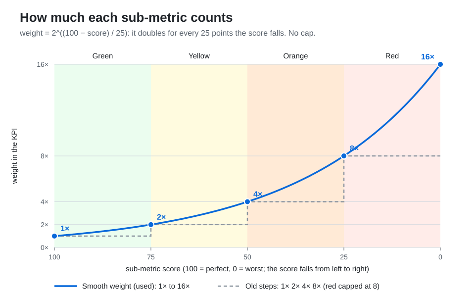

# KPI Scoring Models

Each KPI in the pack (Performance, Consumption, Risk) is one number built from many sub-metrics. Every sub-metric gets a color from its source table: green, yellow, orange or red. The colors encode vSphere guidance. For example, an ESXi CPU Imbalance of 1.6 or more is red, and ballooning above 4 % of DRAM is red.

The way the colors are combined decides what the KPI tells the people who act on it. This page compares three ways to combine them, based on how each behaves in VMware Cloud Foundation operations: on dashboards, in alerts, in the Close for Business decision, and when many clusters are compared.

The pack uses the first model, the **weighted average by color**. The calculation is described in [How the pack scores a KPI](#how-the-pack-scores-a-kpi) below. Each KPI's own page lists its sub-metrics and their limits, for example [Cluster Performance](../reference/metrics/cluster-performance.md).

## The three models

| | Weighted average by color | Weighted sum by color | Worst color |
| :--- | :--- | :--- | :--- |
| Summary | Every sub-metric counts, worse colors count more, and the KPI is the weighted average. | Every sub-metric adds to the KPI according to its color. Nothing is averaged. | The KPI takes the color of its worst sub-metric. More sub-metrics of that color push it further. |
| One red sub-metric among green ones | Visible, but softened by the green ones. One red usually reads as orange. | Visible at full strength, regardless of the green ones. | The KPI is red. |
| Several red sub-metrics | Each one counts. | Each one counts. Two reds can already reach the end of the scale. | Each one pushes the KPI further into red. |
| A sub-metric gets worse | The KPI can move the wrong way. See [A worse sub-metric can lower Cluster Risk](../reference/metrics/cluster-risk.md#known-limitation-a-worse-sub-metric-can-lower-cluster-risk). | The KPI never moves the wrong way. | The KPI never moves the wrong way. It does not move at all while a worse color exists elsewhere. |
| What the KPI color tells the operator | A blend: a yellow KPI can hide a red sub-metric. | A total: many yellow sub-metrics can add up to a red KPI. | A guarantee: a red KPI means at least one sub-metric is red. |
| Comparing many clusters | Works well, because the KPI rarely reaches the end of the scale. | Weak at the top: many bad clusters all show 100. | Works within a color, but clusters with the same color and depth tie. |

## Rank-based weights (considered, not used)

A fourth model is the Ordered Weighted Average (OWA, Yager 1988). It sorts the sub-metrics from worst to best and weights them by rank: the worst counts 8×, the second 4×, the third 2× and the fourth 1×, whatever their colors. It is the standard fix for an average that moves the wrong way, because a sub-metric's weight can't jump when its value changes.

It does not suit VMware Cloud Foundation operations. The colors in the source tables carry the meaning of each sub-metric, and ranking discards that meaning. A second red sub-metric counts half as much as the first only because it comes second, and a fifth red one barely counts. The result is mathematically sound, but an operator can't relate it to the colors of the sub-metrics on the screen.

## Weighted average by color

**What the operator sees.** A KPI that reflects both how bad and how widespread a problem is. A cluster with one bad sub-metric and many good ones scores better than a cluster where several are bad. A sub-metric's weight rises smoothly as its score falls, from 1 at its best to 16 at its worst (see [How the pack scores a KPI](#how-the-pack-scores-a-kpi)). The KPI moves smoothly and rarely reaches 0 or 100, so it is good for ranking many clusters. vSphere World uses it this way for the worst cluster and the Worst 10 Percent (the 10th or 90th percentile, depending on the direction of the KPI). See [vSphere World](../reference/metrics/vsphere-world-metrics.md).

**Where it fails.** When the KPI is already bad, a sub-metric that gets worse can make the KPI look better. In Cluster Risk, a leading indicator that turns yellow or orange lowers the KPI if other indicators are worse. This matters for decisions: the Close for Business rule checks Risk at orange, so a cluster just inside orange can drop to yellow after more VMs are deployed, and open again.

**Best fit.** Watching trends and ranking clusters, where a small error in direction is acceptable.

## Weighted sum by color

**What the operator sees.** A KPI that only grows as sub-metrics get worse, with every bad sub-metric adding its part. It shows how much is wrong in total.

**Where it fails.** It runs out of scale. Once two sub-metrics are red the KPI is at the end of the scale, so a cluster with two red leading indicators looks the same as one with six. A sum also needs a fixed scale: someone has to decide how many reds make 100, and the source tables don't say.

**Best fit.** A yes-or-no decision that must never move the wrong way, such as closing a cluster, where the difference between bad and very bad doesn't change the answer.

## Worst color

**What the operator sees.** The same logic as a vCenter alarm: an object is red when one of its alarms is red, however many others are green. The KPI color can be checked against the sub-metrics without a calculator.

**Where it fails.** It ignores how widespread a problem is. While one sub-metric is red, the yellow and orange ones don't move the KPI. A cluster with one red indicator and five orange ones scores the same as a cluster with only the red one.

**Best fit: availability.** In availability, one failed component can take a whole ESXi host down, so the worst component decides. Availability adds one more rule, because some failures override all others: losing all disks is worse than losing one disk, one NIC, one HBA, one fan and one PSU together. Availability therefore uses two tables:

1. The first table scores partial failures, component by component.
2. The second table lists the failures that take the host down on their own.

The score is the **minimum** of the two tables, so a dead host scores as dead whatever the first table says.

## Why performance and capacity differ from availability

In performance and capacity management, the impact on live operations rarely comes from one component alone:

- **Contention adds up.** VMs that wait for CPU, memory and disk are hurt more than VMs that wait for one of them. A model that looks only at the worst sub-metric misses this.
- **Leading indicators combine.** Overcommit, reservations, monster VMs and imbalance each make contention arrive sooner. Two of them at orange bring it closer than one.
- **A color shows a level of pressure.** An orange sub-metric means the cluster is under pressure, but it still runs every VM. A dead component means the host is down.

For these reasons the pack combines the sub-metrics instead of taking the worst one, and for these three KPIs the direction of the KPI matters as much as its color.

## How the pack scores a KPI

Every KPI uses the calculation below. A KPI's own page lists its sub-metrics and their limits. The code is in [`kpi_score.py`](../../Management%20Pack/app/metrics/kpi_score.py).

### Five limits per sub-metric

Each sub-metric has five limits: the values where its score is 100, 75, 50, 25 and 0. They divide the values into four tiers. Within a tier, the score changes linearly:

| Tier | Value range | Score from → to |
| :--- | :--- | :--- |
| Green | best limit to green limit | 100 → 75 |
| Yellow | green limit to yellow limit | 75 → 50 |
| Orange | yellow limit to orange limit | 50 → 25 |
| Red | orange limit to zero-at limit | 25 → 0 |

Beyond the zero-at limit the score stays at 0. A value better than the best limit scores 100.

- **Lower is better** (for example CPU Ready): the limits increase.
- **Higher is better** (for example Guest Free Memory): the limits decrease. The same calculation handles both.
- **The best limit is not always 0.** For Worst ESXi CPU Imbalance it is 1, one running thread per running core, so every value up to 1 scores 100.

### Combining the sub-metrics

```
KPI = Σ(score × weight) / Σ(weight)
weight = 2^((100 − score) / 25)
```

The weight depends on the score, not on the tier. It is 1 at score 100, 2 at 75, 4 at 50, 8 at 25 and 16 at 0, and changes smoothly in between, so the KPI does not jump when a value crosses a limit.



With a plain average, one sub-metric in the red tier is hidden by nine healthy ones. With the weights it stays visible. For example, with 10 sub-metrics, nine at 100 and one at 18.75 (red):

- Plain average: about 91.9. The problem is hidden.
- Weighted: `(9 × 100 + 18.75 × 9.51) / (9 + 9.51)` ≈ 58.25. The problem shows.

### Rounding

Each value is rounded to two decimals before it is scored, and the KPI is calculated from the rounded values. This way the KPI matches the sub-metric values that users see.

### Green as a single value

Some source tables give green as one value, such as "0 %", rather than a range. In that case the green limit equals the best limit. Only exactly 0 is green and scores 100. Any other value starts in yellow, at 75 with weight 2. Because values are rounded first, noise below 0.005 still counts as 0.

### Skip when green

Some source tables mark a green range as "Excluded". For these sub-metrics a green value says nothing about health: dropped packets are rare, and low CPU or memory utilization is not a sign of good performance. If they scored 100 every cycle, they would dilute the other sub-metrics. So while such a value is green, the sub-metric is left out of the KPI, as if it had no data. Once it leaves green, it counts like any other sub-metric.

- Green means the value is at the best limit or better, or has not reached the green limit. The check uses the value, not the weight, because the weight changes smoothly.
- If every sub-metric with data is skipped this way, nothing is wrong and the KPI is 100.

Which sub-metrics are skipped when green, and why, is listed in the "Excluded" section of each KPI: [Cluster Performance](../reference/metrics/cluster-performance.md), [VM Performance](../reference/metrics/vm-performance.md), [Cluster Risk](../reference/metrics/cluster-risk.md) and [ESXi Performance](../reference/metrics/esxi-performance.md).

### Missing data

A sub-metric with no data is left out of the KPI. It is never counted as 0, because for most sub-metrics 0 means "perfect" and would make the object look healthier than it is.

- If no sub-metric has data, the KPI is not published for that cycle. If some had data but all were skipped when green, the KPI is 100.
- In the code, a sub-metric with no data returns `None`, never 0.

How the code is organised is described in [Metrics Code](../development-guide/metrics-code.md).

## Related

- [Capacity Management Model](capacity-management.md): how Consumption, Contention and Risk decide whether a cluster can take more VMs.
- [Cluster Risk](../reference/metrics/cluster-risk.md), [Cluster Consumption](../reference/metrics/cluster-consumption.md), [Cluster Performance](../reference/metrics/cluster-performance.md): the KPIs and their sub-metrics.
