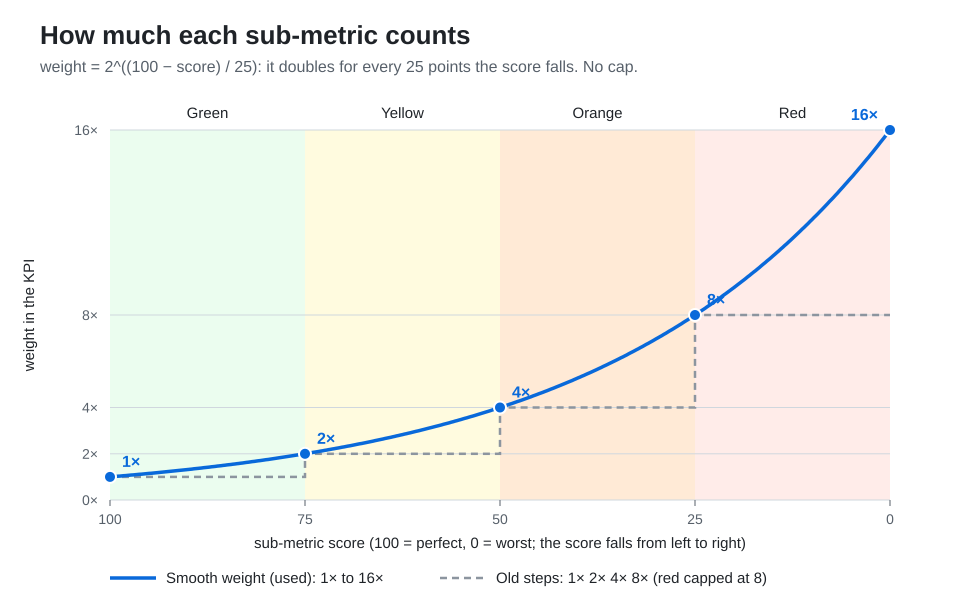

# KPI Scoring Models

Each KPI of the pack (Performance, Consumption, Risk) is one number built from many sub-metrics. Every sub-metric gets a color from its source table: green, yellow, orange or red. The colors are vSphere judgments: an ESXi CPU Imbalance of 1.6 or more is red, ballooning above 4 % of DRAM is red.

How the colors are combined into one number decides what that number means to the people who act on it. This page compares three ways of combining them, by what each one does in VMware Cloud Foundation operations: dashboards, alerts, the Close for Business decision, and the comparison of many clusters.

The pack uses the first one, the **weighted average by color**. How it is calculated is in [How the pack scores a KPI](#how-the-pack-scores-a-kpi), below. Each KPI's own page gives its sub-metrics and their limits, for example [Cluster Performance](../reference/metrics/cluster-performance.md).

## The three models

| | Weighted average by color | Weighted sum by color | Worst color |
| :--- | :--- | :--- | :--- |
| In one sentence | Every sub-metric counts; a worse color counts more, and the KPI is their average. | Every sub-metric adds to the KPI by its color; nothing is averaged. | The KPI takes the color of its worst sub-metric. Sub-metrics of that same color push it deeper. |
| A red sub-metric among green ones | Shows, but the green ones soften it: one red usually reads orange. | Shows at full strength, whatever the green ones do. | The KPI is red. |
| Several red sub-metrics | Each counts. | Each counts. Two reds can already reach the end of the scale. | Each pushes the KPI deeper into red. |
| A sub-metric gets worse | The KPI can move the wrong way. See [A worse sub-metric can lower Cluster Risk](../reference/metrics/cluster-risk.md#known-limitation-a-worse-sub-metric-can-lower-cluster-risk). | The KPI never moves the wrong way. | The KPI never moves the wrong way. While a worse color exists elsewhere, it does not move at all. |
| What the color of the KPI tells the operator | A mix: a yellow KPI can hide a red sub-metric. | A total: many yellow sub-metrics can make the KPI red. | A fact: a red KPI means at least one sub-metric is red. |
| Comparing many clusters | Good: the KPI rarely reaches the end of the scale. | Weak at the top: many bad clusters show the same 100. | Good within a color, but clusters of the same color and depth tie. |

## Weights by rank: considered, not used

A fourth model is known in mathematics as the Ordered Weighted Average (OWA, Yager 1988). It sorts the sub-metrics from worst to best and gives the weight by rank: the worst counts 8×, the second 4×, the third 2×, the fourth 1×, whatever their colors. It is the standard fix for an average that moves the wrong way, because no sub-metric's weight can jump when its value changes.

It does not fit VMware Cloud Foundation operations. The colors of the source tables carry the meaning of each sub-metric in vSphere, and ranking throws that meaning away. A second red sub-metric counts half as much as the first only because it is second, and a fifth red one does not count at all. The number is mathematically correct, but an operator cannot relate it to the colors of the sub-metrics in front of them.

## Weighted average by color

**What the operator sees.** A KPI that blends depth and breadth. A cluster with one bad sub-metric and many good ones reads better than a cluster where several are bad. A sub-metric's weight rises smoothly as its score falls, from 1 at its best to 16 at its worst (see [How the pack scores a KPI](#how-the-pack-scores-a-kpi)). The number moves smoothly, and it rarely reaches 0 or 100, so many clusters can be ranked, as [vSphere World](../reference/metrics/vsphere-world-metrics.md) does with the highest and the 90th percentile.

**Where it fails.** When the KPI is already bad, a sub-metric that gets worse can make it look better: in Risk, a newly yellow or orange leading indicator lowers Cluster Risk if other indicators are worse. This happens where the decisions are made. The Close for Business rule reads Risk at orange, and a cluster just inside orange can drop to yellow after VMs are deployed, and open again.

**Best fit.** Watching trends and ranking clusters, where a small error in direction is tolerable.

## Weighted sum by color

**What the operator sees.** A KPI that only grows as sub-metrics get worse, and where every bad sub-metric adds its part. It answers "how much is wrong, in total".

**Where it fails.** It runs out of scale. Once two sub-metrics are red, the KPI is at its end, so a cluster with two red leading indicators looks the same as one with six. A sum also needs a fixed scale: someone decides how many reds make 100, and that choice is not in the source tables.

**Best fit.** A yes or no decision that must never go the wrong way, such as whether to close a cluster, where losing the difference between bad and very bad does not change the answer.

## Worst color

**What the operator sees.** The same logic as an alarm in vCenter: an object is red when one of its alarms is red, however many others are green. The color of the KPI can be checked against its sub-metrics without a calculator.

**Where it fails.** It ignores breadth across colors. While one sub-metric is red, the yellow and orange ones do not move the KPI. A cluster with one red indicator and five orange ones reads the same as one with only the red indicator.

**Best fit: availability.** In availability, one failed component can take a whole ESXi host down, so the worst component decides. Availability adds one more rule: some failures override the rest. All disks failed is worse than one failed disk, one NIC, one HBA, one fan and one PSU together. So availability uses two tables:

1. The first table scores the partial failures, component by component.
2. The second table lists the failures that, alone, take the host down.

The score is the **minimum** of the two tables. A dead host scores as dead, whatever the first table says.

## Why performance and capacity differ from availability

In performance and capacity management, the impact on live operations does not come from one component alone:

- **Contention adds up.** VMs that wait for CPU and also for memory and disk are hurt more than VMs that wait for one of them. A model that looks at the worst sub-metric only does not see that.
- **Leading indicators combine.** Overcommit, reservations, monster VMs and imbalance each make contention arrive earlier. Two of them at orange bring it closer than one.
- **The color is a level, not a state.** An orange sub-metric is not a failure: the cluster still runs every VM. A dead component is a state: the host is down.

That is why the pack combines the sub-metrics instead of taking the worst one, and why the direction of the KPI, not only its color, matters for these three KPIs.

## How the pack scores a KPI

This is the mechanism every KPI shares. A KPI's own page lists its sub-metrics and their limits. The code is in [`kpi_score.py`](../../Management%20Pack/app/metrics/kpi_score.py).

### Five limits per sub-metric

Each sub-metric has five limits. They are the values where its score is 100, 75, 50, 25 and 0. The limits split the values into four tiers, and inside a tier the score falls in a straight line:

| Tier | Value range | Score goes from → to |
| :--- | :--- | :--- |
| Green | best up to the green limit | 100 → 75 |
| Yellow | green limit up to the yellow limit | 75 → 50 |
| Orange | yellow limit up to the orange limit | 50 → 25 |
| Red | orange limit up to the zero-at limit | 25 → 0 |

Beyond the zero-at limit the score stays at 0. Before the best limit it stays at 100.

- **Lower is better** (CPU Ready): the limits go up.
- **Higher is better** (free memory): the limits go down. The same calculation handles both.
- **The best limit does not have to be 0** (CPU Run): every value up to it scores 100.

### Combining the sub-metrics

```
KPI = Σ(score × weight) / Σ(weight)
weight = 2^((100 − score) / 25)
```

The weight depends on the score, not on the tier. It is 1 at score 100, 2 at 75, 4 at 50, 8 at 25 and 16 at 0, and changes smoothly in between. So the KPI does not jump when a value crosses a limit. The earlier weight was one step per tier (1, 2, 4, 8), with red capped at 8: that was the jump the change removed (issue #18).



With a plain average, one sub-metric in the red tier is hidden by nine healthy ones. With the weights it shows. Example with 10 sub-metrics, nine at 100 and one at 18.75 (red):

- Plain average: about 91.9. The problem is hidden.
- Weighted: `(9 × 100 + 18.75 × 9.51) / (9 + 9.51)` ≈ 58.25. The problem shows.

### Rounding

Each value is rounded to two decimals before it is scored, and the KPI is calculated from the rounded values. So the KPI matches the numbers a user sees on the sub-metrics.

### Green as a single value

Some source tables give green as one value, such as "0 %", not a range. Then the green limit equals the best limit. Only exactly 0 is green and scores 100. Any other value starts in yellow, at 75 with weight 2. Values are rounded first, so noise below 0.005 still counts as 0.

### Skip when green

Some source tables mark a green range as "Excluded". Being green there says nothing about health: dropped packets are rare, and low CPU or memory utilization is not a sign of good performance. Scored as 100 every cycle, these rows would add a free pass that hides the other sub-metrics. So while such a value is green, the sub-metric is left out of the KPI, as if it had no data. Once it leaves green, it counts like any other sub-metric.

- Green means at or below the best limit, or below the green limit. The check uses the value, not the weight, because the weight changes smoothly.
- If every sub-metric with data was skipped this way, nothing is wrong, and the KPI is 100.

Which sub-metrics skip when green, and why, is listed in the "Excluded" section of each KPI: [Cluster Performance](../reference/metrics/cluster-performance.md), [VM Performance](../reference/metrics/vm-performance.md), [Cluster Risk](../reference/metrics/cluster-risk.md) and [ESXi Performance](../reference/metrics/esxi-performance.md).

### Missing data

A sub-metric with no data is left out of the KPI. It is never counted as 0. For most sub-metrics 0 means "perfect", so counting it would make the object look healthier than it is.

- If no sub-metric has data, the KPI is not published for that cycle. If some had data but all were skipped when green, the KPI is 100.
- In the code, a sub-metric with no data returns `None`, never 0.

For how the code is organised to do this, see [Metrics code](../development-guide/metrics-code.md).

## Related

- [Capacity Management Model](capacity-management.md): how Consumption, Contention and Risk decide whether a cluster takes more VMs.
- [Cluster Risk](../reference/metrics/cluster-risk.md), [Cluster Consumption](../reference/metrics/cluster-consumption.md), [Cluster Performance](../reference/metrics/cluster-performance.md): the KPIs and their sub-metrics.
