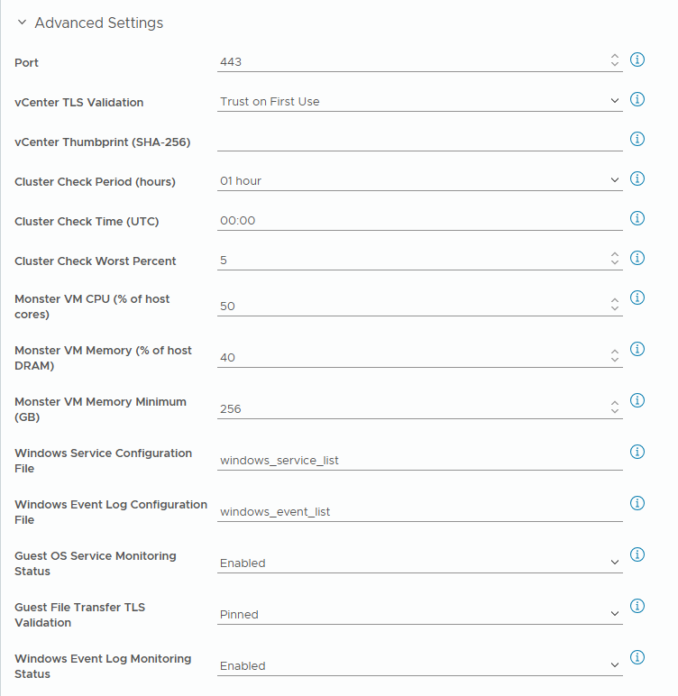
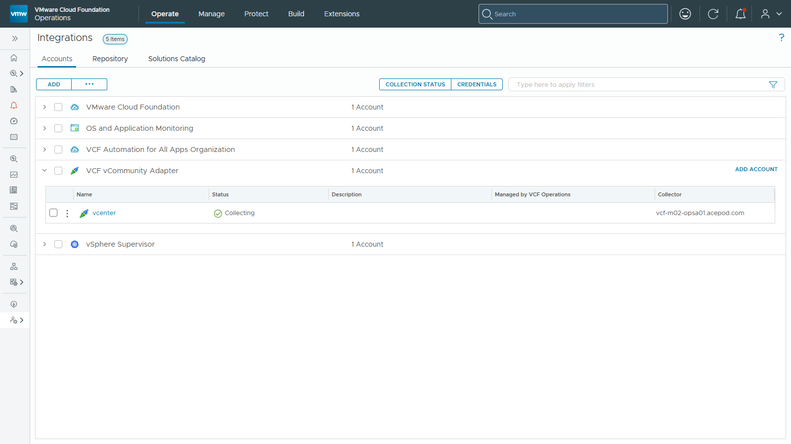

# Adapter Instance

An Adapter Instance connects the pack to one vCenter Server. Create one for each vCenter after you have installed the pack and set the [policy](policy.md). To create many at once, use the [Bulk Adapter Instance Importer](../../tools/importer/importer.md).

**On this page:**

- [1. Creating the Adapter Instance](#1-creating-the-adapter-instance)
- [2. Advanced Settings](#2-advanced-settings-optional)
- [3. Validate the Configuration](#3-validate-the-configuration)

---

## 1. Creating the Adapter Instance

1. Go to **Administration** > **Integrations** > **Repository**.
2. Click the **VCF vCommunity Adapter** tile.
3. Click **Add Account**.

Before you start:

- Activate the [policy](policy.md) first. The host network metrics the pack needs are off by default.
- The vCenter name must resolve on the Cloud Proxy. A name that resolves on your workstation can still fail on the Cloud Proxy, and the reverse is also true.
- If automatic collector placement fails with `Could not find any compatible and up collector in the collector group`, select a Cloud Proxy that is up and can reach the vCenter.

The examples on this page use vCenter `vcenter.example.com`, account `svc-vcfops@vsphere.local` and Cloud Proxy `cloud-proxy-01.example.com`.

### 1.1. Account Details

| Field | Description | Note |
| :--- | :--- | :--- |
| **Name** | A name for the Adapter Instance. | For example `VCF-Ops-vCenter-Prod`. |
| **Description** | What this instance is for. | Optional. |
| **vCenter Server** | The FQDN or IP address of the vCenter Server. | **Use exactly the same FQDN or IP as the vCenter's own (native) Adapter Instance.** The pack matches on this value to find the vCenter objects it publishes on. If it differs, nothing is published. |
| **Credential** | A **vCenter Credential**: **vCenter User Name** and **vCenter Password**, plus the optional **Windows User Name** and **Windows Password**. | The Windows fields are needed only for Windows Service or Windows Event Log monitoring. See [User Account Requirements](../installation-guide/system-requirements.md#user-account-requirements). |
| **Collector/Group** | The Cloud Proxy or collector group that runs the instance. | It must reach the vCenter Server. Collection starts within about 5 minutes. |

### 1.2. Configuration File Selection

Configuration files list what the pack collects. The pack installs six of them, under **Infrastructure Operations** > **Configurations** > **Management Pack Configuration** > **System Defined**. Enter a file's name **without** `.xml`. The pack adds the extension.

The four files below are references: every entry in them is commented out, so with the defaults the pack collects none of these settings. Clone a file, uncomment the entries you want, and enter the clone's name here. See [Customization](customization.md).

| Field | Default | What is collected |
| :--- | :--- | :--- |
| **ESXi Advanced System Settings Config File** | `esxi_advanced_system_settings` | The ESXi advanced system settings listed in the file, as shown on a host's **Configure** tab in vCenter. |
| **ESXi Software Packages Config File** | `esxi_packages` | Name, version, vendor and acceptance level of the software packages (VIBs and drivers) listed in the file. See the [note on software packages](#a-note-on-esxi-software-packages). |
| **VM Advanced Parameters Config File** | `vm_advanced_parameters` | The VM advanced parameters (`.vmx` settings) listed in the file, as shown in the vCenter MOB under a VM's `config.extraConfig`. |
| **VM Options Config File** | `vm_options` | The VM configuration fields listed in the file, as vSphere property paths such as `config.flags.diskUuidEnabled`, as shown in the vCenter MOB under a VM's `config` object. A path that does not exist stops the VM collection for the cycle, see [Configuration Files](../troubleshooting-guide/configuration-files.md). |

#### A note on ESXi software packages

Reading software packages takes one call per host (`fetchSoftwarePackages()`), which is slower than the batched reads the pack uses for everything else. With hundreds of hosts this adds to the collection time. If you don't track VIBs or drivers, leave `esxi_packages` with no active entries.

---

## 2. Advanced Settings (Optional)

Click **Advanced Settings** to see the settings below.

*Some values in the screenshot differ from the defaults. The table gives the defaults.*

| Advanced Setting | Default | Description |
| :--- | :--- | :--- |
| **Port** | `443` | The HTTPS port of the vCenter Server. |
| **vCenter TLS Validation** | `Trust on First Use` | `Trust on First Use` connects whatever certificate vCenter presents, and reports on the vCenter object when the certificate changes. It sends the user name and password before the certificate is checked, so use `Pinned` or `Enabled` on a network you don't fully trust. `Enabled` (the Cloud Proxy must trust the certificate) and `Pinned` (it must match the thumbprint below) refuse the connection when the check fails. See [TLS and Security Settings](tls-and-security.md#vcenter-tls-validation). |
| **vCenter Thumbprint (SHA-256)** | *(empty)* | The certificate thumbprint to accept. Used only when vCenter TLS Validation is `Pinned`. |
| **Cluster Check Period (hours)** | `24` | The length of each [Periodic Cluster Check](../reference/metrics/periodic-cluster-check.md#settings) window, and how often the check runs: 1, 2, 4, 6, 8, 12 or 24 hours. |
| **Cluster Check Time (UTC)** | `00:00` | The time of day, as HH:MM in UTC, when a Periodic Cluster Check window ends. With a shorter period, the other windows end every period from this time. An empty or invalid value means `00:00`. |
| **Cluster Check Worst Percent** | `5` | The share of the worst samples in each [Periodic Cluster Check](../reference/metrics/periodic-cluster-check.md#worst) window that is ignored. `0` uses the single worst sample. Range 0 to 50. |
| **Monster VM CPU (% of host cores)** | `50` | A VM is a CPU monster when its vCPUs are more than this percentage of its host's physical cores. Used by [Cluster Risk](../reference/metrics/cluster-risk.md#when-a-vm-is-a-monster). Range 1 to 100. |
| **Monster VM Memory (% of host DRAM)** | `40` | A VM is a memory monster when its memory is more than this percentage of its host's DRAM, or more than the minimum below, whichever is smaller. Range 1 to 100. |
| **Monster VM Memory Minimum (GB)** | `256` | A VM with at least this much memory is a memory monster on any host. On a host where the percentage of DRAM gives a lower limit, smaller VMs already count. |
| **Windows Service Configuration File** | `windows_service_list` | The configuration file that lists the Windows services to check. The default file has no active entries. |
| **Guest OS Service Monitoring Status** | `Disabled` | `Enabled` checks the listed Windows services in every Windows VM and also reads OS information (name, version, build number, architecture, release ID and last boot time). |
| **Windows Event Log Configuration File** | `windows_event_list` | The configuration file that lists the Windows event logs and event IDs to collect. The default file lists six event IDs in the `Application`, `Security`, `Setup` and `System` logs. |
| **Windows Event Log Monitoring Status** | `Disabled` | `Enabled` collects the listed events from every Windows VM. |
| **Guest File Transfer TLS Validation** | `Pinned` | How the ESXi host certificate is checked when a script is sent to a Windows VM. `Pinned`: it must match the thumbprint that vCenter records for the host. When vCenter has none, the transfer goes ahead and the log says so. `Strict`: as `Pinned`, but a host without a thumbprint is skipped. `Disabled`: no check. See [TLS and Security Settings](tls-and-security.md#guest-file-transfer-tls-validation). |

### Before you turn on Windows monitoring

Both Windows features run a PowerShell script in each Windows VM through VMware Tools. They add load to VCF Operations and to each VM, and the load grows with the number of Windows VMs. The setting applies to every Windows VM the Adapter Instance collects: there is no per-VM scope. To limit the effect:

- Keep the service and event lists short.
- Test on an Adapter Instance for a small vCenter first.
- Know the limits: each PowerShell step is stopped after 5 minutes, and all guest work in one cycle stops after 30 minutes. VMs that were not reached wait for the next cycle. See [TLS and Security Settings](tls-and-security.md#what-runs-inside-a-windows-vm).

---

## 3. Validate the Configuration

Click **Validate Connection**. It connects to the vCenter with the instance's settings and reports what failed, if anything. Then save the instance.

After the first collection cycle, the Adapter Instance shows **Collecting** under **VCF vCommunity Adapter** in **Administration** > **Integrations** > **Accounts**:

If it does not, see [First Steps](../troubleshooting-guide/first-steps.md).

---

**Next:** [Customization](customization.md): choose what each Adapter Instance collects.
