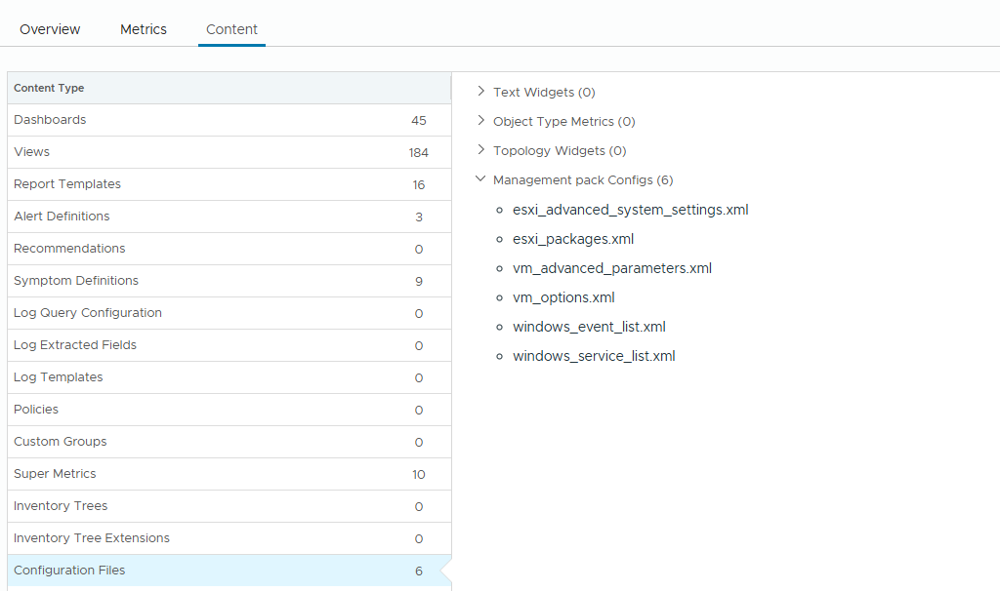

# Customization

Each Adapter Instance names the configuration files it uses, so different vCenters can collect different settings, for example production and non-production. The files that the pack installs are references: the four files for ESXi and VM settings have every entry commented out and collect nothing. To collect something, clone a file, edit the clone, and enter the clone's name in the Adapter Instance.

The pack installs six configuration files. They are listed in its **Management Pack Details** (**Administration** > **Integrations** > **Repository** > **VCF vCommunity Adapter**), under **Content** > **Configuration Files**:

| File | What it lists |
| :--- | :--- |
| `esxi_advanced_system_settings` | ESXi advanced system settings |
| `esxi_packages` | ESXi software packages (VIBs and drivers) |
| `vm_advanced_parameters` | VM advanced parameters (`.vmx` settings) |
| `vm_options` | VM option property paths, such as `config.flags.diskUuidEnabled` |
| `windows_service_list` | Windows services to check |
| `windows_event_list` | Windows event logs and event IDs to collect |

Don't edit the installed files. An upgrade of the pack overwrites them.

## Create a custom configuration file

1. Go to **Infrastructure Operations** > **Configurations** > **Management Pack Configuration** > **System Defined**.
2. Find the file, for example `esxi_advanced_system_settings`.
3. Click the **Clone** icon, and give the copy a name that says what it is for, for example `esxi_adv_settings_non_prod`.
4. Edit the copy. Uncomment or add only the settings you want to collect in that environment. Keep the file valid XML: [Configuration Files](../troubleshooting-guide/configuration-files.md) lists the common mistakes.
5. Open the Adapter Instance ([Adapter Instance](adapter-instance.md#1-creating-the-adapter-instance)). In the matching **Configuration File Selection** field, enter the name of the copy **without** `.xml`, for example `esxi_adv_settings_non_prod`. The pack adds the extension. A name entered with `.xml` is not found, and the pack reports a configuration event on the vCenter object.

The change takes effect at the next collection cycle.

Collect only what you need. A property stays on an object once it has been collected, and each VM advanced parameter is read for every VM, so a long list adds to the collection time.

Use these files to match the pack to your hardening guide, KB articles or internal standards. See [Why the pack exists](../README.md#why-the-pack-exists).

---

**Next:** [Business Applications](business-applications.md)
