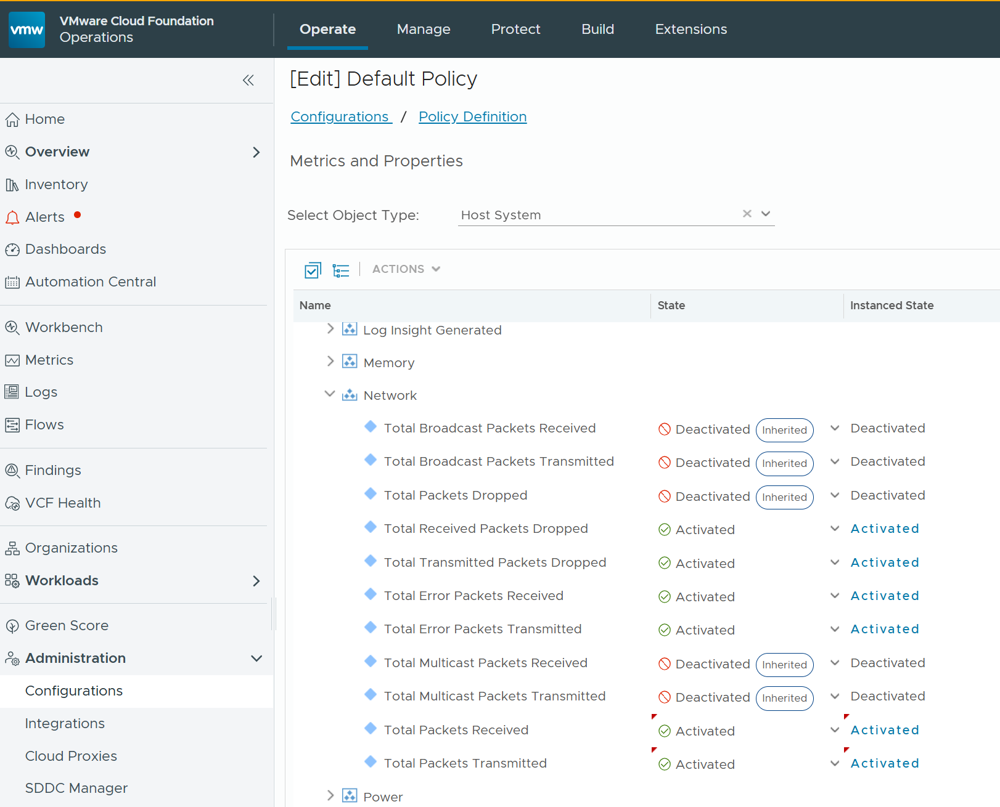

# Policy: Activate the Required Metrics

Some host network metrics and properties that the pack reads are **deactivated by default** in VCF Operations. Until you activate them, the features below have no data. Activate them in the policy that applies to your ESXi hosts. The steps below use the Default Policy.

| Feature without data | Activate under Host System > **Network** | State | Instanced State |
| :--- | :--- | :--- | :--- |
| Bad Network Packets (in Cluster Performance and ESXi Performance) | **Total Packets Received** (`net|packetsRx_summation_sum`) | Activated | Optional |
| | **Total Packets Transmitted** (`net|packetsTx_summation_sum`) | Activated | Optional |
| [Network Speed Degradation](../reference/metrics/network-speed-degradation.md) | **Configured Speed** (`net|configuredSpeed`), a property | Activated | **Activated**, because a value per physical NIC is needed |

1. Go to **Administration** > **Configurations** > **Policy Definition**.
2. Edit the **Default Policy** and open **Metrics and Properties**.
3. Set **Select Object Type** to **Host System**.
4. Expand **Network**.
5. Set the states as in the table above.
   - **Configured Speed** is listed with the properties of **Network**. Its tooltip reads: *"The configured network speed of the network card. If this is higher than actual, the card is not operating at its full capacity."*
   - **Actual Speed** (`net|speed`), next to it, is activated by default. Leave it on.
6. Check that these four are **Activated**, as they are by default:
   - **Total Received Packets Dropped** (`net|droppedRx_summation_sum`)
   - **Total Transmitted Packets Dropped** (`net|droppedTx_summation_sum`)
   - **Total Error Packets Received** (`net|errorsRx_summation_sum`)
   - **Total Error Packets Transmitted** (`net|errorsTx_summation_sum`)
7. Save the policy.

The metrics have data from the next collection cycle.

To check the result, open an ESXi host: `net:vmnic0|configuredSpeed` appears as a property next to `net:vmnic0|speed`. A NIC set to auto-negotiate has no configured speed, so it has no `configuredSpeed` property and the metric leaves it out. See [Network Speed Degradation](../reference/metrics/network-speed-degradation.md#known-limitations).

## Alerts and super metrics

The pack's alerts and super metrics are also off after the install. They are optional, and you turn them on in the same policy. [Included Content](../user-guide/included-content.md#turn-on-the-alerts) lists them and the object types to enable them on.

---

**Next:** [Create an Adapter Instance](adapter-instance.md)
