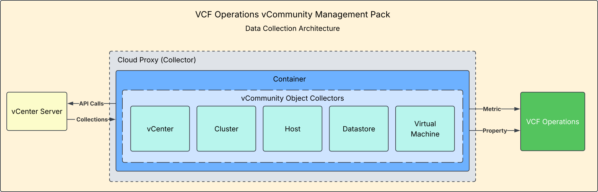
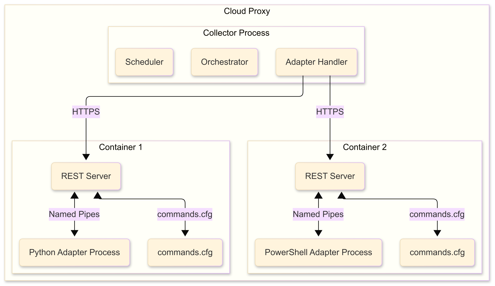

# How It Works

## How the pack runs

Management Packs built with the VCF Operations Integration SDK run their Adapter Instances on a **Cloud Proxy**, not on the VCF Operations cluster nodes.

When you install the `.pak` file and create an Adapter Instance, the Cloud Proxy pulls the adapter's container image from the registry. The image is built from the pack's `Dockerfile`: a base image from the SDK, the Python libraries, and the adapter code. The Cloud Proxy then starts the container, which collects from vCenter and from VCF Operations every collection cycle (5 minutes) and sends the results to VCF Operations.

If the Cloud Proxy can reach the registry, nothing else is needed: install the pack and create the Adapter Instances. If it cannot, see [Dark Site Installation](dark-site.md).

## How the Integration SDK works

A Cloud Proxy runs a collector process that manages one adapter container per Adapter Instance. Each container holds a REST server and the adapter. The `commands.cfg` file tells the REST server which command to run for each call (`test`, `collect`, `adapter_definition` and `endpoint_urls`). Each call starts a new adapter process, so nothing is kept in memory from one cycle to the next. [App Folder](../development-guide/app-folder.md) describes a collection cycle in detail.

---

**Next:** [Installation](installation.md)
