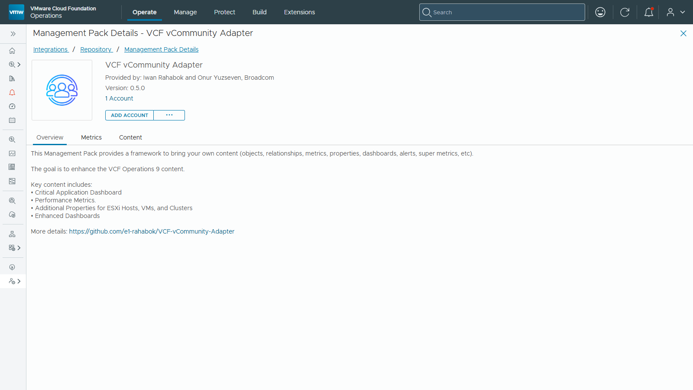
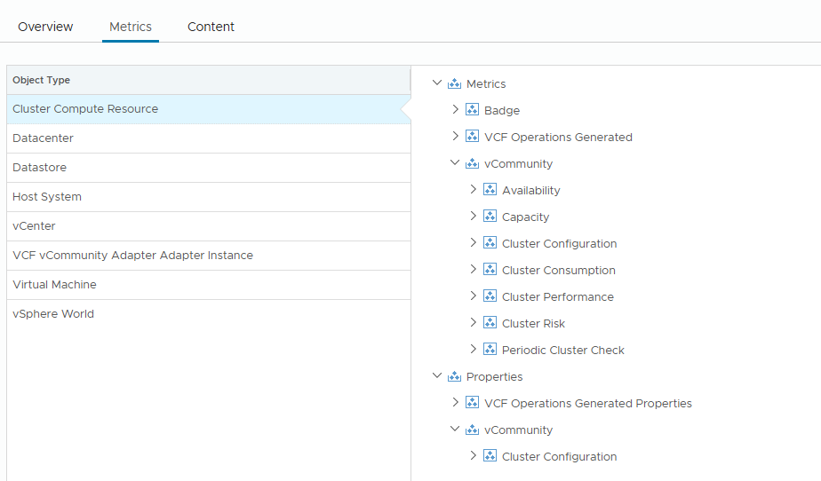
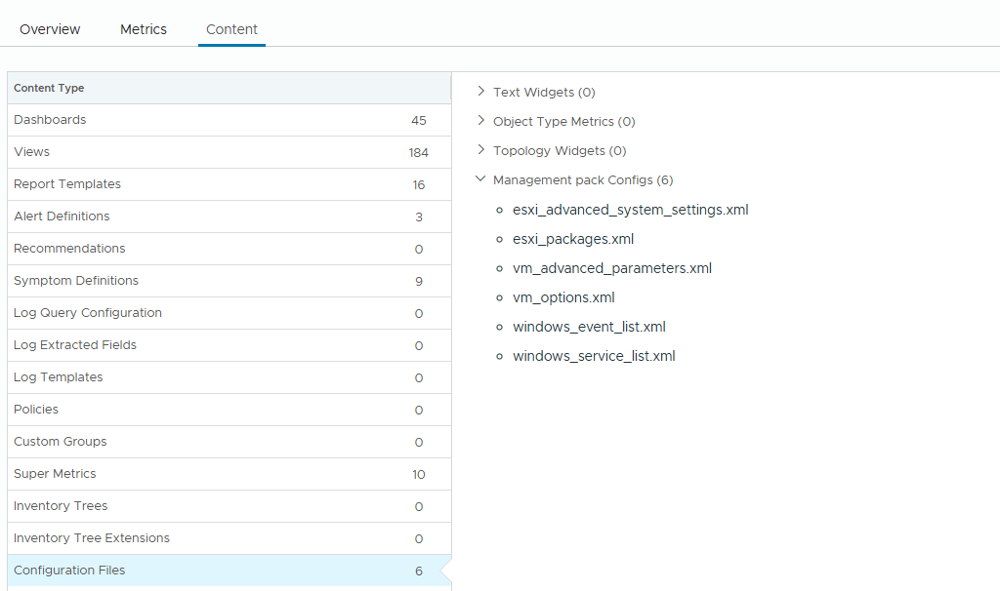

# Installation

**On this page:**

- [Get the PAK file](#get-the-pak-file)
- [Enable Unsigned PAK Installation](#enable-unsigned-pak-installation)
- [Install the Management Pack](#install-the-management-pack)
- [Create the Adapter Instance](#create-the-adapter-instance)
- [After an Upgrade: Restart Collection](#after-an-upgrade-restart-collection)
- [Upgrade From a Version That Shipped Built-in View Ids](#upgrade-from-a-version-that-shipped-built-in-view-ids)

---

## Get the PAK file

Download `vCommunity_<version>.pak` from the [Releases](https://github.com/e1-rahabok/VCF-vCommunity-Adapter/releases) page. Each release from 0.8.1 on has the validated `.pak` file attached.

## Enable Unsigned PAK Installation

The `.pak` file is not signed by VMware or Broadcom, because this is a community project (see the [README](../../README.md)). Allow unsigned PAK files once per VCF Operations instance:

1. Open `https://<VCF_Ops>/admin` and go to **Administrator Settings** > **Security Settings**.
2. Turn on **Activate Unsigned PAK Installation**.

The installation wizard then shows the **Ignore the PAK file signature checking** checkbox.

## Install the Management Pack

1. Go to **Administration** > **Integrations** > **Repository** and click **Add**.
2. Browse to the `vCommunity_<version>.pak` file and select:
   - **Install the PAK file even if it is already installed**, to upgrade or reinstall over an existing version.
   - **Ignore the PAK file signature checking**. This is required because the pack is unsigned.

   Upload the file and click **Next**.
3. Accept the End User License Agreement and click **Next**.
4. When the installation completes, click **Finish**.

The pack appears on the **Repository** tab as **VCF vCommunity Adapter**. Click it to open its **Management Pack Details**:

- **Metrics** lists the metrics and properties the pack adds to each object type, under **vCommunity**:

  

- **Content** lists what the pack installs: dashboards, views, reports, alerts, super metrics and configuration files:

  

Some of this content is off after the install. [Included Content](../user-guide/included-content.md) lists what to turn on.

## Create the Adapter Instance

Installing the pack does not start collection. Create an Adapter Instance for each vCenter, as described in [Adapter Instance](../configuration-guide/adapter-instance.md).

## After an Upgrade: Restart Collection

After you install a new version over an existing one, the existing Adapter Instances can stop collecting. The install reports success, but under **Administration** > **Integrations** > **Accounts** the instance under **VCF vCommunity Adapter** shows **Warning**, its state is `Failed`, and it does not recover by itself. This has happened on several upgrades of the pack. The cause is not known, and it is not listed as a known issue in Broadcom's documentation.

To fix it, do this for each Adapter Instance of the pack:

1. Under **Administration** > **Integrations** > **Accounts**, expand **VCF vCommunity Adapter**.
2. Open the **⋮** menu next to the Adapter Instance and choose **Stop Collecting**.
3. Open the same menu again and choose **Start Collecting**.
4. Wait for the next collection cycle, about 5 minutes. The status changes to **Collecting**, and the tooltip shows **Status: Data receiving**.

Data collected before the upgrade is kept. The time between the install and the restart is a gap in the metrics.

Contributors can restart every Adapter Instance of the pack with one script: see [Restart Script](../../tools/restart/restart.md).

## Upgrade From a Version That Shipped Built-in View Ids

Versions up to 0.8.1 shipped 117 views under the ids of views that are built into VCF Operations. VCF Operations matches a view by its id, so installing the pack replaced the built-in view with the pack's copy, and uninstalling the pack deleted the view. Stock dashboards and reports that use a built-in view then showed "The view does not exist". This version does not ship those ids:

- 19 views that were identical to the built-in view, or differed only in title or description, are no longer shipped. The pack's dashboards use the built-in view.
- The other 98 views have new ids. They are the pack's own views, and they keep their names.
- Three more views, VCF Management Services Nodes View, Volumes View and Components View, were added in this repository, and are not among the 117, with the ids of views that are built into VCF Operations 9.1.1. They are not present in an 8.18.7 content export. They have new ids too. Components View is identical to the built-in view of 9.1.1, but it is not dropped, so the pack's dashboard keeps its own copy of it on every version.

The built-in views are no longer overwritten. What happens to the built-in views when you upgrade from an affected version depends on the VCF Operations version:

| VCF Operations | What the upgrade does |
| :--- | :--- |
| 9.0.2 and 9.1.1 | The platform removes content that the new version no longer ships, so **the upgrade deletes the 117 built-in views** that the old version had overwritten. The pack's views with the new ids are added. |
| 8.18.7 | The old copies stay. Each of the 98 views then appears twice with the same title, once under the old id and once under the new id. The old copies are deleted when the pack is uninstalled. |

These results were measured with the 0.3.1 release of the original pack, which shipped the same 117 ids, not with a `.pak` file built from this repository.

To restore the built-in views after an upgrade on 9.0.2 or 9.1.1, import them from a content export of a clean instance of the same VCF Operations version, one that never had the pack installed. Export the views from that instance, then import the file into your instance.

---

**Next:** [Policy](../configuration-guide/policy.md), then [Adapter Instance](../configuration-guide/adapter-instance.md).
