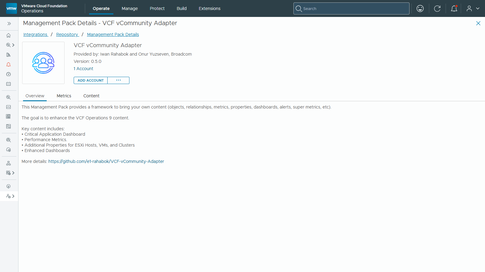
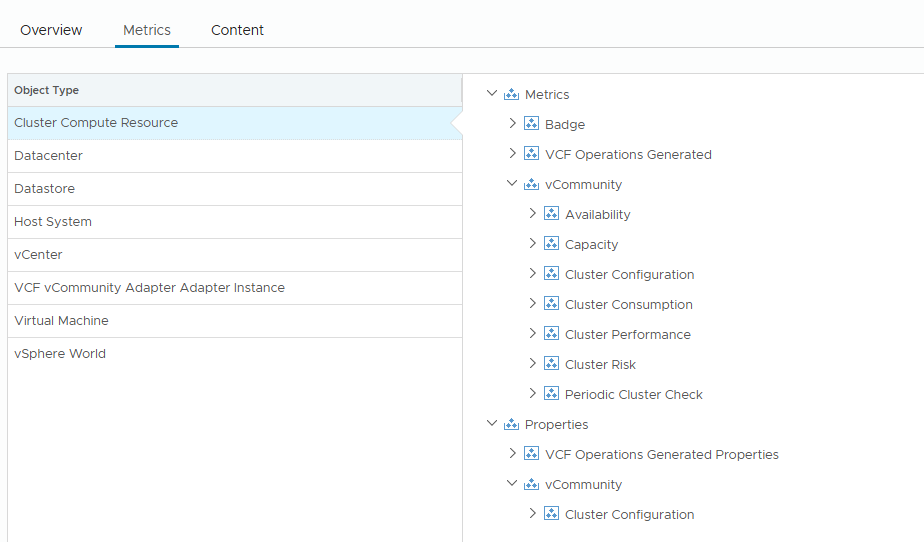
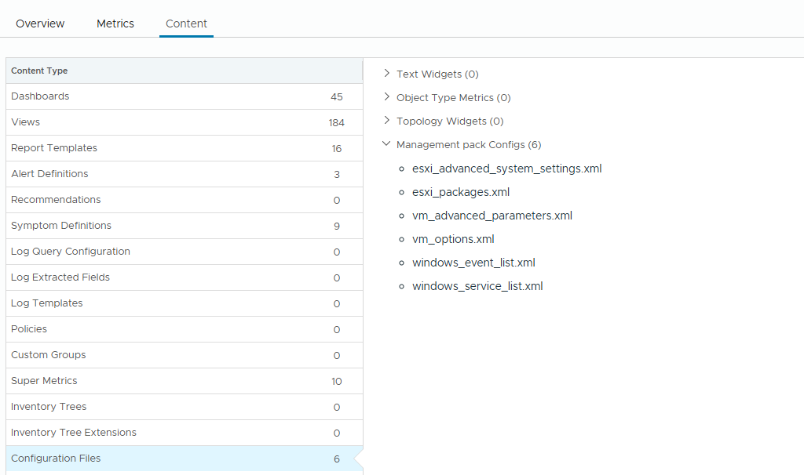

# Installation

**On this page:**

- [Enable Unsigned PAK Installation](#enable-unsigned-pak-installation)
- [Install the Management Pack](#install-the-management-pack)
- [After an Upgrade: Restart Collection](#after-an-upgrade-restart-collection)

---

## Enable Unsigned PAK Installation

Since the PAK file is not signed by VMware/Broadcom (this is a community-built, unofficial Management Pack — see the main [README](../../README.md)), you need to enable unsigned PAK installation once per VCF Operations instance:

1. Go to `https://<VCF_Ops>/admin` → **Administrator Settings** → **Security Settings** → **Activate Unsigned PAK Installation**.

After enabling this, the **"Ignore the PAK file signature checking"** checkbox will appear during the PAK installation wizard.

---

## Install the Management Pack

1. Navigate to **Administration** → **Integrations** → **Repository** tab, and click **Add**.
2. Browse to the `vCommunity_x.x.x.pak` file. Select:
   - **"Install the PAK file even if it is already installed"** — to override an existing installation.
   - **"Ignore the PAK file signature checking"** — required, since this Management Pack is unsigned.

   Upload the file and click **Next**.
3. Accept the End User License Agreement, then click **Next**.
4. Once installation completes, click **Finish**.

You can review the VCF Operations vCommunity Management Pack under the **Repository** tab. Click **VCF vCommunity Adapter** to open its **Management Pack Details**:

- **Metrics** lists, for each object type, the metrics and properties the pack adds, under **vCommunity**:

  

- **Content** lists what the pack installs: dashboards, views, reports, alerts, super metrics and its configuration files:

  

---

## Create the Adapter Instance

Installing the pack does not create an Adapter Instance. Create one for each vCenter, following [Adapter Instance](../configuration-guide/adapter-instance.md). The instance is what starts collection.

## After an Upgrade: Restart Collection

When you install a new version over an existing one, the existing Adapter Instances can stop collecting. The install itself reports success, but under **Administration** → **Integrations** → **Accounts**, the instance under **VCF vCommunity Adapter** shows **Warning**. Its state is `Failed`, and it does not collect again by itself.

To fix it, for each Adapter Instance of the pack:

1. Under **Administration** → **Integrations** → **Accounts**, expand **VCF vCommunity Adapter**.
2. Click the **⋮** menu next to the Adapter Instance and choose **Stop Collecting**.
3. Open the same menu again and choose **Start Collecting**.
4. Wait for the next collection cycle, about 5 minutes. The status turns to **Collecting**, and the tooltip shows **Status: Data receiving**.

Data collected before the upgrade is kept. The time between the install and the restart is a gap in the metrics.

Contributors can run these steps for every Adapter Instance of the pack with one script: see [Restart Script](../../tools/restart/restart.md).

This has happened on several upgrades of this pack, among them 0.4.1 to 0.4.2 on VCF Operations 9.1.1. It is not listed as a known issue in Broadcom's documentation, and the cause is not known yet.

---

**Next:** [Configure the policy](../configuration-guide/policy.md), then [create an Adapter Instance](../configuration-guide/adapter-instance.md).
