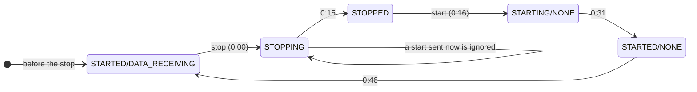

# Restart Script

`restart.ps1` stops and starts collection on every Adapter Instance of this pack, and waits until each one is collecting again. It does the same as **Stop Collecting** and **Start Collecting** in Administration → Integrations → Accounts, for all the pack's instances at once.

After a pak upgrade, the pack's Adapter Instances often stop collecting until their collection is restarted: see [After an Upgrade: Restart Collection](../../docs/installation-guide/installation.md#after-an-upgrade-restart-collection). Run this script after [`install.ps1`](../install/install.md), and before the [live validation](../validate/validate.md).

## Safety

The script **changes the instance**: it stops collection on every Adapter Instance of adapter kind `vCommunity`, then starts it again. While an instance is stopped, the pack collects nothing for its vCenter, so a restart can leave a short gap in the pack's metrics. Adapter Instances of other adapters, such as the vCenter adapter, are not touched.

It does not change any setting of the Adapter Instances.

TLS certificates are not checked (`-SkipCertificateCheck`), as in `validate.ps1`. It is meant for a test instance on a trusted network.

## Requirements

- PowerShell 7 (`pwsh`).
- A VCF Operations account that can stop and start collection on Adapter Instances.
- The URL and login in `.secrets/vcf-ops.xml`, created as described in [Live Validation Test Plan](../validate/validate.md#requirements), or passed as parameters.

## Running it

From the repo root:

```powershell
pwsh tools/restart/restart.ps1
```

| Parameter | Default | Meaning |
| :--- | :--- | :--- |
| `-TimeoutMinutes` | `15` | How long step 5 waits for every instance to collect again. |
| `-StopTimeoutMinutes` | `2` | How long step 3 waits for every instance to report stopped. |
| `-Url`, `-Credential`, `-SecretFile` | `.secrets/vcf-ops.xml` | Where to connect. |

Exit code `0` means every instance reports `STARTED/DATA_RECEIVING`. `1` means at least one does not, or an error stopped the script. The last lines list each instance as `PASS` or `FAIL`, with its state.

## What it does

The script prints each step before running it, and each instance's state every time it changes, with the elapsed time. All calls go to the Suite API, after a token from `POST /suite-api/api/auth/token/acquire`.

| Step | What the script prints | Request |
| :--- | :--- | :--- |
| 1 | Logging in | `POST /suite-api/api/auth/token/acquire`, then `GET /suite-api/api/versions/current` |
| 2 | Finding the Adapter Instances of adapter kind vCommunity | `GET /suite-api/api/adapters?adapterKindKey=vCommunity`, then each instance's state from `GET /suite-api/api/resources/{id}` |
| 3 | Stopping collection | `PUT /suite-api/api/adapters/{adapterId}/monitoringstate/stop` for each instance, then the state every 15 s until each is `STOPPED` |
| 4 | Starting collection | `PUT /suite-api/api/adapters/{adapterId}/monitoringstate/start` for each instance |
| 5 | Waiting until every instance is collecting | The state every 15 s, until each is `STARTED/DATA_RECEIVING` |

The stop and start calls are `stopMonitoringResourcesOfAdapterInstance` and `startMonitoringResourcesOfAdapterInstance` in the instance's own API reference (Public APIs, `/suite-api/doc/swagger-ui.html`). Both take the Adapter Instance's ID and return 200 with no content. The similar `/api/resources/.../monitoringstate` calls act on single objects, not on an Adapter Instance, and are not used.

The state is the one Administration → Integrations → Accounts shows, as `resourceState/resourceStatus`. On the lab, with one Adapter Instance on VCF Operations 9.1.1, a restart went through these states:

| State | Seen at |
| :--- | :--- |
| `STARTED/DATA_RECEIVING`, before the stop | 0:00 |
| `STOPPING` | 0:00 |
| `STOPPED` | 0:15 |
| `STARTING/NONE`, after the start | 0:16 |
| `STARTED/NONE` | 0:31 |
| `STARTED/DATA_RECEIVING` | 0:46 |



## Design decisions

**Wait for `STOPPED` before starting.** A start sent while an instance is still `STOPPING` is ignored, and the instance then stays `STOPPED`. The first version of the script started as soon as the state left `STARTED`, and left the lab's instance stopped. The script now waits for `STOPPED`. If an instance has not stopped after `-StopTimeoutMinutes`, it is started anyway, and the script says so.

**Done means `STARTED/DATA_RECEIVING`.** `STARTED/NONE` means the instance runs but has not delivered data yet. The script waits for `DATA_RECEIVING`, as `validate.ps1` checks for it.

**Every instance of the pack, none of the others.** The upgrade problem is on this pack's instances. Restarting other adapters would stop their collection for no reason.

## Troubleshooting

| Message | Cause | Fix |
| :--- | :--- | :--- |
| `No Adapter Instance of adapter kind 'vCommunity' found` | The pack is not installed, or has no Adapter Instance | Create one: see [Adapter Instance](../../docs/configuration-guide/adapter-instance.md). |
| `still STOPPING … starting it anyway` | The instance took longer than `-StopTimeoutMinutes` to stop | If it ends `STOPPED`, run the script again, or raise `-StopTimeoutMinutes`. |
| An instance ends `STOPPED` | The start was not accepted | Run the script again. If it stays stopped, start it in Administration → Integrations → Accounts and read the adapter log. |
| An instance ends `STARTED/NONE` or `FAILED` | It runs but delivers no data, for example a wrong credential or an unreachable vCenter | Open the instance in Administration → Integrations → Accounts and use **Validate Connection**. Read the adapter log on the Cloud Proxy. |
| `401` or `403` on a `PUT` | The account cannot stop or start collection | Use an account with that permission, such as `admin`. |
